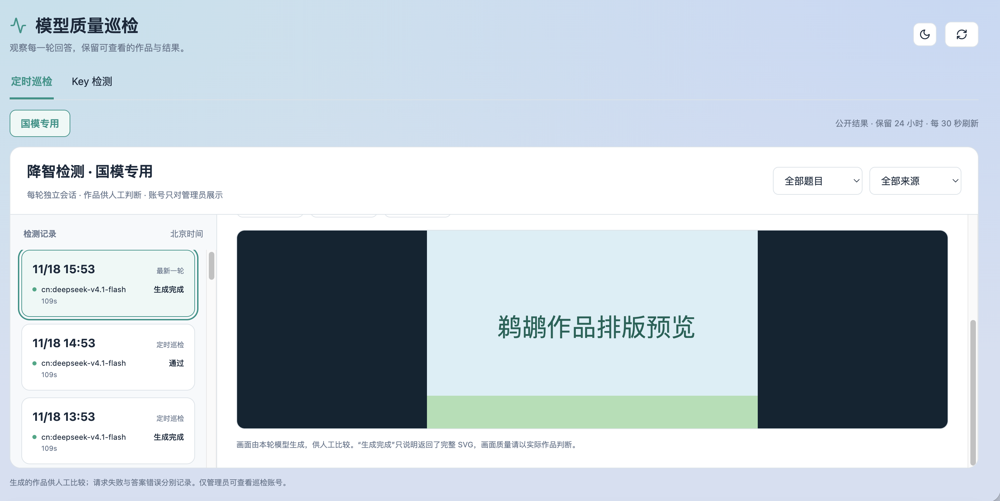
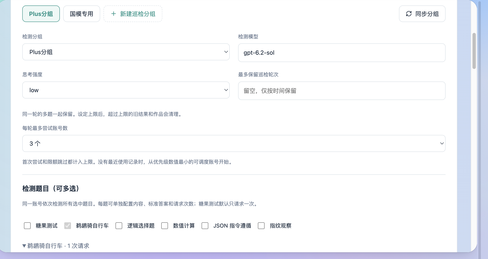
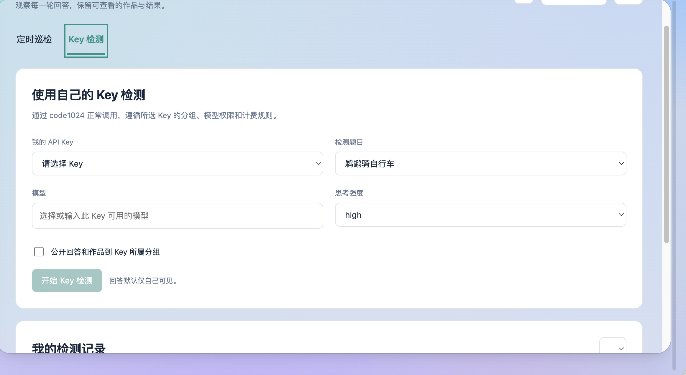

# Sub2API 模型质量巡检

为 [Sub2API](https://github.com/Wei-Shaw/sub2api) 提供分组定时巡检、用户 Key 自助检测和结果看板。服务通过 Sub2API 的现有 API 接入，独立运行在 Docker 容器中，可通过后台的自定义菜单嵌入。接入无需修改 Sub2API 源码或直连其数据库。

## 功能

- **分组巡检**。按分组配置模型、思考强度、题目、巡检间隔和暂停时段。遇到上游限额、超时等故障，可在同组内按优先级换账号继续，每轮尝试上限可配置。
- **多题检测与结果回看**。支持数值、选择、JSON 等标准答案题，也可以用「鹈鹕骑自行车」等 HTML/SVG 题目观察模型输出。结果保留原回答、判定、耗时和作品，单独显示请求故障与额度不足。
- **用户 Key 自助检测**。用户登录 Sub2API 后选择自己的 API Key，通过网关调用模型，沿用该 Key 的分组权限、额度和计费。结果默认仅本人可见，可主动分享到所属分组。
- **可选的自动剔除与复测**。启用后，标准答案题明确答错可暂时停用对应账号的调度，对该账号所属的所有分组生效。冷却到期后复测原账号，通过后恢复调度。此功能默认关闭，需要单独配置可修改账号调度状态的管理员 Key。
- **结果访问控制**。默认登录后可查看分组结果，管理员可开放匿名查看。账号信息仅管理员可见。

## 界面截图

### 分组巡检结果



### 巡检设置



### Key 自助检测



## Docker 部署

准备一个已运行的 Sub2API 实例、一个巡检服务 HTTPS 域名，以及安装了 Docker Compose v2 的主机。巡检容器需要能访问 Sub2API，分组巡检还需要能访问目标账号的上游或代理。

### 1. 下载并配置

```bash
git clone https://github.com/daQzi/code1024-drool-router.git
cd code1024-drool-router
cp config.example.json config.json
mkdir -p credentials
(umask 077; openssl rand -hex 32 > credentials/web-token; touch credentials/sub2api-admin)
```

在 `config.json` 中更新以下字段，保留其余配置。将示例域名换成自己的地址。

```json
{
  "base_url": "https://api.example.com",
  "web": {
    "session_auth_url": "https://api.example.com",
    "public_origin": "https://inspect.example.com",
    "frame_ancestors": ["https://api.example.com"]
  }
}
```

`base_url` 和 `session_auth_url` 从容器访问，可以使用同一实例的内网地址。`public_origin` 填浏览器访问巡检服务的来源，`frame_ancestors` 填浏览器访问 Sub2API 的来源。来源只包含协议、域名和可选端口。

`credentials/web-token` 是容器监听所需的随机口令。定时巡检的管理员 API Key 可在页面配置，或写入 `credentials/sub2api-admin`。先用登录会话验证页面时，该文件可以留空。

### 2. 启动巡检服务

```bash
docker compose build
```

容器以 `drool` 用户运行。用专用组或 ACL 让该用户能读取 `config.json`、进入 `credentials/` 并读取所用凭据文件。可运行 `docker compose run --rm --no-deps drool id` 查看容器用户的 UID 和 GID。

```bash
docker compose up -d
curl -fsS http://127.0.0.1:4191/healthz
```

默认对宿主机只开放 `127.0.0.1:4191`，使用 HTTPS 反向代理对外提供页面。可直接参考 [Nginx 配置示例](deploy/nginx.conf.example)。巡检配置和历史保存在 Compose 的 `drool-data` 卷，升级前请备份数据卷。

### 3. 在 Sub2API 添加入口

1. 以管理员身份进入 Sub2API 的「系统设置 → 站点设置 → 自定义菜单页面」，添加菜单「模型质量巡检」，地址填写 `https://inspect.example.com/?embed=1`。需要开放用户 Key 自测时，将菜单设为用户可见。
2. 从新菜单进入巡检页面。宿主将登录会话传给嵌入页，服务通过同一 Sub2API 实例的 `/api/v1/auth/me` 校验身份。嵌入地址应指向自己部署的服务，反代配置应避免记录初次访问 URL 的查询参数。
3. 打开「巡检设置」，点「同步分组」，选择一个分组，配置账号实际支持的模型和题目并保存。按下一节配置好上游账号凭据后，可点「按已保存配置巡检一次」验证。同步只读取元数据，执行巡检会发出真实模型请求。

### 4. 启用定时巡检

分组巡检使用目标账号的凭据直连上游。启用定时巡检还需要管理员机器 Key 读取目标分组和账号。可在「巡检读取凭据」配置机器 Key，也可使用部署时挂载的管理员 Key 文件。

- **网关允许账号导出时**，巡检服务可通过 `/api/v1/admin/accounts/data` 按账号读取凭据。
- **导出需要二次认证或机器 Key 无导出权限时**，通过管理员正常授权流程取得目标账号凭据，使用受保护的本地凭据文件或定期刷新的快照，并以只读方式挂载。OpenAI OAuth 账号还需要及时更新的令牌和可读取的账号配额策略。可先用一个上游 API Key 类型的账号验证接入。

手动验证通过后，在「巡检设置」启用该分组的定时巡检并保存。

不同 Sub2API 版本的管理权限和账号字段可能有差异。完整功能需目标实例支持账号和分组管理 API、自定义菜单传递的登录会话，以及对应的账号凭据读取方式。自动剔除另需账号 `schedulable` 接口的写权限。详见 [分组巡检、凭据与自动剔除](docs/inspection-v3.md#机器凭据) 和 [本地凭据文件配置](docs/code1024-standalone.md#账号导出有二次认证时)。

## 上游与许可

本项目在 [NoonWake.AI 的 AI Drool Router](https://github.com/noonwake-ai/ai-drool-router) 基础上二次开发，增加了独立巡检控制台、Sub2API 页面嵌入、分组定时巡检与用户 Key 自助检测。保留原项目版权声明 © NoonWake.AI，沿用 **LGPL-3.0-or-later**，许可全文见 [LICENSE](LICENSE) 和 [COPYING](COPYING)。
